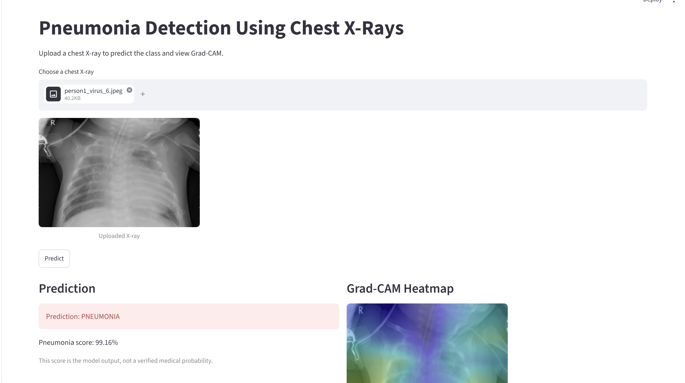
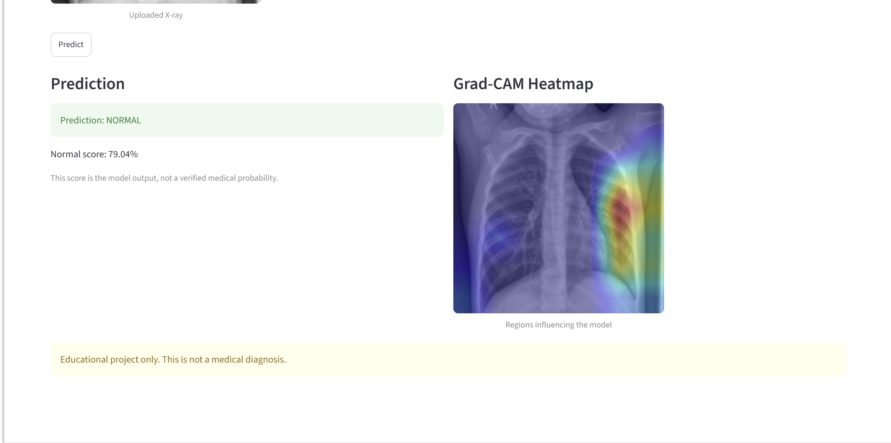

# 🫁 Pneumonia Detection Using DenseNet121, GANs and Grad-CAM

## 📌 Project Overview

Pneumonia is a respiratory infection that affects the lungs and can be identified through medical imaging. This project explores the use of deep learning to classify chest X-ray images into two categories: **NORMAL** and **PNEUMONIA**.

The system uses a pretrained **DenseNet121 convolutional neural network** for image classification, **Generative Adversarial Networks (GANs)** to explore synthetic chest X-ray image generation, and **Grad-CAM** to visualize image regions that influence the model's prediction.

A **Streamlit web application** provides an interactive interface for uploading a chest X-ray and viewing the model's output and heatmap visualization.

> **Note:** This is an educational prototype, not a clinically validated diagnostic system. Predictions must not replace assessment by a qualified healthcare professional.

---

## 🎯 Project Objectives

- Classify chest X-ray images as NORMAL or PNEUMONIA.
- Apply transfer learning using DenseNet121.
- Explore GANs for synthetic medical-image generation.
- Use Grad-CAM to visualize regions influencing predictions.
- Build an interactive web interface using Streamlit.
- Record and analyze model training and evaluation results.

---

## 🧰 Technologies Used

| Technology | Purpose |
|---|---|
| Python | Main programming language |
| TensorFlow / Keras | Deep learning and model training |
| DenseNet121 | Chest X-ray classification |
| GANs | Synthetic image generation experiments |
| Grad-CAM | Prediction visualization |
| OpenCV and NumPy | Image processing |
| Matplotlib | Graphs and visualizations |
| Google Colab | Cloud-based experimentation |
| Google Drive | Dataset and model storage |
| Streamlit | Web application interface |

---

## 🖼️ 1. Chest X-Ray Dataset Visualization

The dataset contains chest X-ray images organized into NORMAL and PNEUMONIA categories. Sample images are visualized before model training to understand the input data and class labels.

**Figure 1: Sample chest X-ray images**

Add the screenshot showing the six labeled X-ray images here.

---

## 🧠 2. DenseNet121 Classification Model

DenseNet121 is a convolutional neural network with dense connections between layers. These connections allow features learned by earlier layers to be reused by later layers.

For this project, a pretrained DenseNet121 backbone is combined with a global average pooling layer, dropout, and a sigmoid output layer for binary classification.

### Classification workflow

1. Upload or load a chest X-ray image.
2. Resize the image to 224 × 224 pixels.
3. Apply DenseNet121 preprocessing.
4. Pass the image through the trained model.
5. Obtain a pneumonia probability and classification output.

The predicted class is based on the model's output and the decision threshold configured in the application.

---

## 🔥 3. Grad-CAM Explainability

Gradient-weighted Class Activation Mapping (Grad-CAM) creates a heatmap that highlights image regions contributing to a model's prediction.

The visualization contains three parts:

- **Original X-ray:** The input chest X-ray image.
- **Grad-CAM heatmap:** A color-coded representation of model activation.
- **Heatmap overlay:** The heatmap superimposed on the original image.

### Example Grad-CAM result

Add the screenshot showing the original X-ray, Grad-CAM heatmap, and heatmap overlay here.

In the supplied example, the model predicted **PNEUMONIA**, with a displayed pneumonia score of **0.9837**. This score represents the model output for that particular image; it does not establish a confirmed medical diagnosis.

Grad-CAM is a visualization aid and does not guarantee that the model is focusing on medically meaningful features.

---

## 🧬 4. Generative Adversarial Network (GAN)

A Generative Adversarial Network consists of two neural networks:

- **Generator:** Learns to produce synthetic images resembling the training data.
- **Discriminator:** Learns to distinguish real images from generated images.

During training, these networks compete with one another, allowing the generator to improve its synthetic outputs.

### GAN experiment results

Insert the actual screenshots from Google Colab showing:

- Generated synthetic chest X-ray images.
- Generator loss across training epochs.
- Discriminator loss across training epochs.

These visualizations help document the GAN experiment. Synthetic images should not automatically be treated as clinically realistic or as a substitute for real, properly labeled training data.

---

## 📊 5. Training and Evaluation

Training and evaluation results help assess how the classification model behaves on the available dataset.

Include the actual graphs and metrics produced by the notebook:

- Training and validation accuracy.
- Training and validation loss.
- Confusion matrix.
- Classification report.
- Precision, recall, and F1-score.
- ROC curve and AUC, if calculated.

### Evaluation interpretation

Accuracy describes the overall proportion of correct predictions. Precision measures how often positive predictions are correct, while recall measures how many actual positive cases are identified. The F1-score balances precision and recall.

For a medical-image classification experiment, the confusion matrix and class-specific recall are important because a model can perform differently on NORMAL and PNEUMONIA images.

Only report numerical metrics that were actually obtained from the evaluation run. Training accuracy alone does not establish generalization or clinical reliability.

---

## 🌐 6. Streamlit Web Application

The project includes a Streamlit interface intended to make the trained model accessible without manually running prediction code in a notebook.

### Application workflow

1. Open the web application.
2. Upload a chest X-ray image.
3. View the model's predicted category and displayed score.
4. Inspect the Grad-CAM visualization, when available.

**Application screenshots:** Add screenshots of the running Streamlit app, including an example prediction and its heatmap.

The displayed prediction is an experimental model output and must not be used alone to make medical decisions.

---

## 🔗 7. Google Colab Notebook

The complete experimentation notebook is available here:

[**Open the Pneumonia GAN, DenseNet121 and Grad-CAM Notebook**](https://colab.research.google.com/drive/1HbSl2nwz4C-iTLfezUMhaatkqFZKEPGC?usp=sharing)

The notebook contains the project workflow and the experiments available in the shared version, including dataset visualization, model training, GAN experiments, classification outputs, and Grad-CAM results.

A Google account and appropriate notebook access may be required to view or execute it.

---

## ⚙️ 8. Running the Project Locally

### Prerequisites

- Python version compatible with the installed TensorFlow release.
- Git.
- A compatible environment for TensorFlow and Streamlit.
- The trained DenseNet121 model file.

### Installation

Clone the repository:

```bash
git clone https://github.com/Saivarshith-22/Pneumonia-Detection-Using-DenseNet121.git
cd Pneumonia-Detection-Using-DenseNet121
```

Create and activate a virtual environment:

```bash
python -m venv venv
venv\Scripts\activate
```

Install the dependencies:

```bash
python -m pip install -r requirements.txt
```

Start the application:

```bash
python -m streamlit run app.py
```

The trained model must be available at the location expected by `app.py`. Large model files and datasets may need to be downloaded separately.

---

## ⚠️ Limitations

- Model performance depends on the dataset, labels, preprocessing, and training configuration.
- Dataset imbalance or differences between training and real-world images can affect predictions.
- Grad-CAM visualizations are approximate explanations, not proof of clinical reasoning.
- GAN-generated images may contain artifacts or unrealistic features.
- Clinical use would require independent validation, expert review, and appropriate regulatory assessment.

---

## 🚀 Future Improvements

- Evaluate additional classification architectures.
- Improve class-wise performance and investigate false predictions.
- Compare models using consistent test data and metrics.
- Improve Grad-CAM visualization and interpretation.
- Evaluate the quality and usefulness of GAN-generated images.
- Deploy the application in a properly validated environment.

---

## 👨‍💻 Project Information

**Project:** Pneumonia Detection Using DenseNet121, GANs and Grad-CAM  
## 🧪 Web Application Results

The trained DenseNet121 model is integrated into a web application that accepts chest X-ray images and displays a predicted class: **NORMAL** or **PNEUMONIA**. The application also generates a Grad-CAM heatmap to visualize image regions that influenced the model's prediction.

### 1. Pneumonia Prediction



### 2. Pneumonia Grad-CAM Visualization


### 3. Normal X-ray Prediction


### 4. Normal X-ray Grad-CAM Visualization



*Note: This is an educational deep-learning project, not a substitute for professional medical diagnosis.*

**Domain:** Deep Learning and Medical Image Analysis  
**Interface:** Streamlit  
**Notebook:** Google Colab

This project was developed for academic learning and demonstration.
